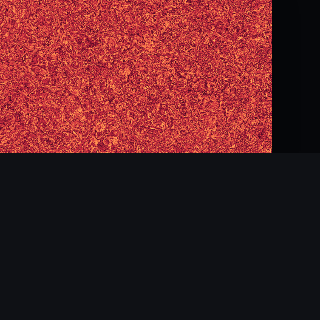
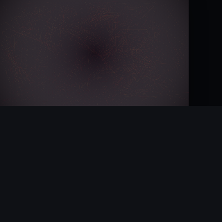
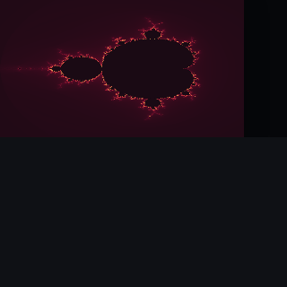
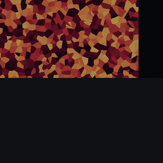

# Wallpaper generator

Pick one of 120 abstract patterns, watch it draw on the canvas, and save the
result as a PNG or a five-second WebM. Every generator is a plain ES module and
Canvas 2D, served as static files: there is no build step and nothing to
install.



[](LICENSE)
[](https://aa-blinov.github.io/wallpaper-generator/)

---

## Quick start

```bash
git clone https://github.com/aa-blinov/wallpaper-generator.git
cd wallpaper-generator
python3 -m http.server 8765
```

Then open http://localhost:8765/.

A file server is required. The page loads ES modules and a module Web Worker,
and a browser refuses both over `file://`, so opening `index.html` from the
disk gives a blank page.

| Server | Command | Notes |
| --- | --- | --- |
| Python | `python3 -m http.server 8765` | Already on macOS and on most Linux distributions. |
| Node | `npx serve .` | Downloads on the first run. |
| PHP | `php -S localhost:8765` | Already on macOS. |
| The published site | <https://aa-blinov.github.io/wallpaper-generator/> | The same files, served by GitHub Pages from `master`. |

The application code has no dependencies. The panel around the canvas is styled
with Bootstrap 5.3.3 and Bootstrap Icons 1.11.3, loaded from jsDelivr by
`index.html`, so the interface needs a network connection and the canvas does
not.

## What it does

- **120 generators** in seven categories: Flow 2, Noise 8, Geometry 33,
  Algorithms 30, Dots 11, Textures 17, Organic 19. They cover flow fields,
  fractal noise, parametric curves, tessellations, escape-time fractals,
  L-systems, cellular automata, dot fields, woven textures and organic
  effects.
- **539 parameters** in total, between 2 and 10 per generator, each one a
  slider with its own range and step, or a menu.
- **12 palettes**, each five anchor colours interpolated from 0 to 1, plus a
  background colour: `lava`, `aurora`, `sunset`, `ink`, `ocean`, `botanic`,
  `bubblegum`, `desert`, `cyber`, `pastel`, `sapphire`, `coral`.
- **A seed you can type.** The seed is a string, and the same seed always
  gives the same picture, so a wallpaper can be found again later by writing
  its number down.
- **Five resolutions**: 1920x1080, 2560x1440, 3840x2160, 1080x1920 and
  1280x720.
- **19 generators move.** The rest draw a static pattern, and the Animated
  button is disabled for them rather than leaving a blank canvas. A speed
  control runs the animation from 0 to 200, where 100 is real time.
- **PNG and WebM.** The PNG is the canvas as it stands. The WebM is five
  seconds recorded from the canvas at 60 frames per second, with VP9 where the
  browser supports it.
- **A URL for every picture.** The style, the palette and the seed go into the
  address, and the same URL gives the same picture on another machine.
  `lite=1` hides the panel and gives the whole window to the canvas.
- **A phone layout.** Below 820 pixels the panel becomes a bottom sheet that
  opens to 84vh, the style list turns into a horizontal strip of cards, and
  the buttons are sized for a finger.

## Screenshots

| Curl Flow | Domain Warp | Mandelbrot | Voronoi |
| :---: | :---: | :---: | :---: |
|  |  |  |  |

All 105 style previews in `docs/` are 320 by 320 crops taken from an earlier
layout, where the canvas sat in the top-left corner of the page. The picture
occupies about 270 by 150 pixels of each square and the rest is the page
background. Six of them, `fern`, `flowsnake`, `flowsnake2`, `halftone`,
`metaballs` and `wire`, show no picture at all: they were captured before the
fixes that made those generators draw, and the files have not been taken again.
`docs/preview-ui.png` is the interface from that same build, before the
interface was translated into English.

## How it works

```
url parameters, panel, keyboard
    -> js/app.js         state, render scheduler, exports
    -> js/styles.js      registry of 120 generators
    -> js/styles/<id>.js one module per generator
    -> canvas 2d
```

`index.html` holds the shell: the panel, the canvas, the overlay that carries
the spinner, and the toast. `js/app.js` holds the state, builds the panel,
drives the keyboard, reads the URL and performs the exports.

`js/styles.js` is the registry. It imports the 120 style modules, exports them
as `STYLES`, and groups them under the seven category names. `js/styles/` holds
one module per generator, plus `rd-worker.js`, the Web Worker that runs the
Reaction-Diffusion simulation.

A style is an object with a fixed shape. `createState(opts, w, h)` returns a
cache that survives between frames, `paint(ctx, opts, state)` draws one frame,
`animate(ctx, opts, state, t)` draws one frame of a moving picture, and
`paintChunked` is the asynchronous variant for the slow ones. `opts` carries
the seed, the palette and the style's own parameters.

The rendering is scheduled rather than immediate. `scheduleRender()` in
`js/app.js` is the single entry point: a heavy change (style, palette, seed,
resolution) puts a spinner over the canvas, and a slider move renders on the
next frame with no overlay at all. While a paint is running, a second one does
not start; the request is kept and picked up when the first one ends.

Randomness is deterministic. `js/rng.js` holds a Mulberry32 generator seeded
from a string, and 37 of the styles derive a numeric seed of their own with
FNV-1a over the user seed and a short suffix, so two styles never draw from
the same stream. The other 34 take no seed at all and are fully determined by
their parameters. `js/noise.js` holds a 2D Simplex noise implementation in the
public domain, with fBM and ridge on top of it.

The canvas is sized by the device pixel ratio, up to 2, so the drawing
coordinates are CSS pixels while the bitmap behind them is larger. Six of the
slow generators (Billow, Cloud Puff, Kaleidoscope, Marble, Ridged and Wood)
paint in chunks and yield to the browser between them, which keeps the panel
responsive while a 4K frame is being computed.

## Configuration

Every parameter is in the URL, either after the `?` or after the `#`. The hash
wins when both carry a value.

| Parameter | Default | What it does |
| --- | --- | --- |
| `style` | `curlflow` | The id of a generator. An id that is not in the registry is ignored and the first style loads instead. |
| `palette` | `lava` | The id of one of the 12 palettes. An unknown id is ignored. |
| `seed` | a random number from 0 to 9999998 | Any text. It is hashed rather than parsed, so `42` and `042` give two different pictures. |
| `resolution` | `1920x1080` | The canvas size, written as `1920x1080`. Any value is accepted, and the canvas follows it. |
| `mode` | `static` | `static` or `animated`. A generator with no animation falls back to static. |
| `lite` | off | `1` hides the panel and gives the whole window to the canvas. `0` means the same as leaving it out. |

Changing the style, the palette or the seed writes the three of them into the
hash as `#style=…&palette=…&seed=…` after a pause of 300 milliseconds. The
resolution, the mode and `lite` are read from the URL and never written to it.

The panel holds the rest.

| Control | Values | Default |
| --- | --- | --- |
| Resolution | 1920x1080, 2560x1440, 3840x2160, 1080x1920, 1280x720 | 1920x1080 |
| Mode | static, animated | static |
| Animation speed | 0 to 200, where 100 is real time | 60 |
| Seed | any text | a random number from 0 to 9999998 |
| Style parameters | 2 to 10 sliders or menus per style | from the style's `defaults` |

| Key | What it does |
| --- | --- |
| `Space` | A new random seed. |
| `Left`, `Right` | The previous or next style. |
| `A` | Switch between static and animated. |
| `S` | Save the PNG. |

## Development

```bash
python3 -m http.server 8765   # the only command in the repository
```

There is no install, no build, no package manifest, no test suite and no
linter. The check that matters is opening the page and looking at the canvas.

A new generator is one file and one import. Create `js/styles/mystyle.js`:

```js
export const mystyle = {
  id: "mystyle",
  name: "My Style",
  category: "Geometry",   // the panel puts it under this heading
  blurb: "One line about what it draws.",
  defaults: { density: 0.0005 },
  params: [
    { key: "density", label: "Density", min: 0.0001, max: 0.001, step: 0.00002 },
    { key: "shape", label: "Shape", enum: ["circle", "line"] },
  ],
  createState(opts, w, h) {
    return { /* the cache that survives between frames */ };
  },
  paint(ctx, opts, state) {
    // One frame.
  },
  animate?(ctx, opts, state, t) {
    // Optional. t is milliseconds since the animation started.
  },
};
```

Then import it in `js/styles.js` and add it to `STYLES`. The panel finds it
through the category field, and the search box finds it by name.

| Path | What it holds |
| --- | --- |
| `index.html` | The shell: the panel, the canvas, the overlay, the toast. |
| `styles.css` | The panel, the stage, the mobile drawer, and the Bootstrap theme overrides. |
| `js/app.js` | The state, the panel, the render scheduler, the keyboard, the URL, the exports. |
| `js/styles.js` | The registry of the 120 generators and the seven categories. |
| `js/styles/` | One module per generator, and `rd-worker.js`. |
| `js/rng.js` | Mulberry32 and three helpers over it. |
| `js/noise.js` | 2D Simplex noise, fBM and ridge. |
| `js/palettes.js` | The 12 palettes, the colour ramp and the mixing helpers. |
| `js/utils.js` | Clamp, lerp, smoothstep, the canvas resize and the download. |
| `docs/` | 105 style previews and one interface screenshot. |

## License

MIT, © 2026 aa-blinov. See [LICENSE](LICENSE).
